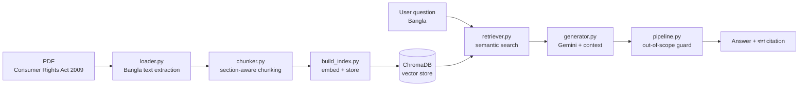
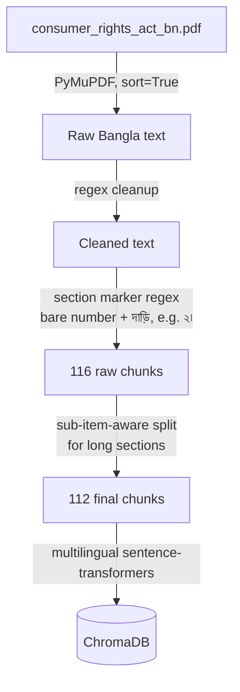

<div align="center">

# ভোক্তা অধিকার সহায়ক — Bangla Consumer Rights Assistant
**A Retrieval-Augmented Generation chatbot for Bangladesh's Consumer Rights Protection Act, 2009**

[](https://www.python.org/)
[](https://fastapi.tiangolo.com/)
[](https://streamlit.io/)
[](https://www.trychroma.com/)
[](https://ai.google.dev/)
[](https://www.docker.com/)
[](LICENSE)

</div>

---

## Overview

Legal documents are hard to read, and most people won't dig through a 30-page government PDF to find out what their rights are when a product turns out to be defective or overpriced. This project reads the actual text of the **Consumer Rights Protection Act, 2009** (ভোক্তা অধিকার সংরক্ষণ আইন, ২০০৯), breaks it into its individual sections (ধারা), and lets a user ask questions in plain Bangla. The system retrieves the relevant section and generates an answer grounded in it — **every answer cites the exact section it came from**, and the system is designed to say "not found" rather than fabricate an answer when a question falls outside the Act.

The project covers the full pipeline a production RAG system needs: Bangla-specific PDF extraction, section-aware chunking, semantic retrieval, LLM-grounded generation, a REST API, a chat UI, an evaluation harness, and containerized deployment.



### Key results

| Aspect | Result |
|---|---|
| Evaluation set | 35 custom Bangla questions across definitions, powers, penalties, procedure |
| Retrieval accuracy | **26/35 (74.3%)** |
| Hallucination rate | **0%** — every miss returned an honest "not found," never a fabricated answer |
| Chunking | 112 section-aware chunks, sub-clause-safe splitting for long sections |
| Deployment | Dockerized; verified working with ≥1GB RAM (see [§6](#6-deployment)) |

---

## Table of contents

1. [Data source](#1-data-source)
2. [Pipeline](#2-pipeline)
3. [Backend and frontend](#3-backend-and-frontend)
4. [Evaluation](#4-evaluation)
5. [Setup](#5-setup)
6. [Deployment](#6-deployment)
7. [Limitations](#7-limitations)
8. [Repository structure](#8-repository-structure)
9. [License and source](#9-license-and-source)

---

## 1. Data source

| Property | Value |
|---|---|
| Document | Consumer Rights Protection Act, 2009 (ভোক্তা অধিকার সংরক্ষণ আইন, ২০০৯) |
| Source | [bdlaws.minlaw.gov.bd](https://bdlaws.minlaw.gov.bd/act-print-1014.html) — Bangladesh Ministry of Law, Justice and Parliamentary Affairs |
| Status | Public-domain government legal document |
| Format | Bangla PDF, ~30 pages, 82 sections (ধারা) across 7 chapters |
| Stored at | `data/raw/consumer_rights_act_bn.pdf` |

**Extraction challenge.** The standard `pdfplumber` library produced broken output on this PDF — Bangla conjunct characters (matra/kar) were reordered incorrectly (e.g. "ভাক্তা" instead of "ভোক্তা"), because the font encodes vowel signs in visual rather than logical order. Switching to **PyMuPDF with `sort=True`** (reading-order-aware extraction) fixed character ordering and substantially improved handling of the PDF's two-column layout (marginal section headings alongside the main text).

---

## 2. Pipeline



### 2.1 Loading — `src/loader.py`
Extracts text with PyMuPDF (`sort=True` for reading-order across the PDF's two-column layout), then applies cleanup regexes (collapsing repeated whitespace, stripping page-number artifacts).

### 2.2 Chunking — `src/chunker.py`
Section markers in this PDF are **bare Bangla numerals followed by a দাড়ি** (`২৷` or `১।`) — not the word "ধারা" as initially assumed from the document's own cross-references. The chunking regex was built empirically, by running a diagnostic pass over the extracted text to confirm the real marker pattern before finalizing it.

Long sections (e.g. ধারা ২, which holds 22 separate definitions) are split further, but **on sub-item boundaries** (`(১)`, `(২)`, …) rather than blindly by character count — this was a deliberate fix after the first character-count-based splitter was found to cut single definitions in half across two chunks, degrading retrieval for exactly the definitions most likely to be asked about.

| Metric | Value |
|---|---|
| Total chunks | 112 |
| Chunking unit | One ধারা, or one sub-item group for long sections |
| Overlap (character-count fallback only) | 100 characters |

### 2.3 Indexing — `scripts/build_index.py` + `src/retriever.py`
Each chunk is embedded with `sentence-transformers/paraphrase-multilingual-mpnet-base-v2` and stored in a **ChromaDB** persistent collection, with `{section}` as metadata. The index is rebuilt from scratch (`store.reset()`) on every run to prevent stale/duplicate vectors from accumulating across re-chunking iterations.

### 2.4 Retrieval + generation — `src/pipeline.py`, `src/generator.py`
For each question, the top-5 nearest chunks are retrieved by embedding distance. If the minimum distance exceeds a threshold (tuned empirically from real query data — relevant matches cluster around 0.2–0.5, so the cutoff is set at 0.85 with margin), the pipeline returns an honest "not found" without calling the LLM. Otherwise, the retrieved chunks are passed to **Gemini** (`gemini-flash-latest`) with a system prompt that restricts it to the provided context, requires a ধারা citation, and includes a standing legal disclaimer.

---

## 3. Backend and frontend

| Component | File | Role |
|---|---|---|
| REST API | `api.py` | FastAPI; `POST /ask` → `{answer, sources, found}` |
| Chat UI | `app.py` | Streamlit; multi-conversation history (ChatGPT-style sidebar), section-citation badges, distinct styling for "not found" responses, custom "official letterhead" visual design |
| Orchestration | `start.sh` | Builds the vector index, then starts both FastAPI and Streamlit inside the same container |

The UI talks to the API over HTTP rather than importing the pipeline directly — this keeps the retrieval/generation logic independently testable and reusable by any other client.

---

## 4. Evaluation

**Script:** `scripts/evaluate.py` · **Question set:** `tests/eval_questions.json` (35 questions) · **Results:** `tests/eval_results.json`

35 Bangla questions were written by hand after reading the full Act, spanning definitions (ধারা ২), institutional structure (ধারা ৫–২২), administrative powers (ধারা ২৩–৩৬), penalties (ধারা ৩৭–৫৬), and complaint/judicial procedure (ধারা ৫৭–৭৬). Each question is paired with its expected source section; a run is scored "correct" if that section appears among the retrieved sources.

| Metric | Value |
|---|---|
| Accuracy | 26 / 35 (**74.3%**) |
| Fabricated answers | 0 |
| Chunking fix impact | 71.4% → 74.3% after switching to sub-item-aware splitting |

**Failure analysis** (full detail in [`tests/EVAL_NOTES.md`](tests/EVAL_NOTES.md)):
- Short, reference-style definitions (e.g. "ভেজাল," which just points to another statute) have weak embeddings against natural-language questions and correctly fall below the retrieval threshold.
- Very broad questions against long, sub-clause-dense sections (e.g. "মহাপরিচালকের ক্ষমতা ও কার্যাবলী কী কী?" against the 22-clause ধারা ২১) sometimes retrieve adjacent, topically-related sections instead of the primary one — a known limitation of pure embedding-based ranking.

In every failure case, the system either declined to answer or clearly stated what it *could* find instead of guessing — it never returned a wrong ধারা citation as if it were correct.

---

## 5. Setup

```bash
git clone https://github.com/mrpaul-10/Bangla-Consumer-Rights-Rag-System.git
cd Bangla-Consumer-Rights-Rag-System

python -m venv venv
venv\Scripts\activate          # Windows
pip install -r requirements.txt
```

Create `.env` in the project root:
```
GOOGLE_API_KEY=your_key_here
```
(Get a free key at [aistudio.google.com](https://aistudio.google.com).)

```bash
python scripts/build_index.py     # builds the ChromaDB index

# Terminal 1
uvicorn api:app --reload

# Terminal 2
streamlit run app.py
```
UI: `http://localhost:8501` · API docs: `http://localhost:8000/docs`

---

## 6. Deployment

```bash
docker build -t bangla-consumer-rights-rag .
docker run -p 8000:8000 -p 8501:8501 --env-file .env bangla-consumer-rights-rag
```

`start.sh` builds the index and starts both services inside one container on first boot.

**Note on free-tier hosting.** This was tested against Render's free tier (512MB RAM), which is below what the multilingual embedding model needs at load time (~1GB), causing an out-of-memory crash loop. The image builds and runs correctly on any host with sufficient memory — this is a documented resource constraint of the free tier, not a defect in the container or the application code.

---

## 7. Limitations

- **Retrieval ranking on broad/long sections** — see [§4](#4-evaluation) and `tests/EVAL_NOTES.md`. A hybrid keyword + semantic search would likely close most of this gap.
- **Residual PDF extraction noise** — a small amount of extra whitespace remains inside some Bangla ligatures after extraction; this does not affect section-marker detection but is visible in raw chunk text.
- **Single-document scope** — the system only knows this one Act; it correctly declines questions outside it (verified with out-of-scope test queries such as weather questions).
- **Not legal advice** — every answer carries a disclaimer recommending a qualified lawyer for complex matters.

---

## 8. Repository structure

```text
.
├── api.py                    FastAPI backend (POST /ask)
├── app.py                    Streamlit chat UI
├── start.sh                  Container entrypoint: build index, start both services
├── Dockerfile
├── requirements.txt
├── src/
│   ├── loader.py              PDF → cleaned Bangla text
│   ├── chunker.py              text → section-wise chunks
│   ├── retriever.py             ChromaDB vector store
│   ├── generator.py              Gemini prompt + generation
│   └── pipeline.py                retrieval + generation + out-of-scope guard
├── scripts/
│   ├── build_index.py             builds/rebuilds the vector index
│   └── evaluate.py                 runs the evaluation question set
├── tests/
│   ├── eval_questions.json         35-question evaluation set
│   ├── eval_results.json            latest evaluation run
│   └── EVAL_NOTES.md                 documented retrieval limitations
└── data/raw/
    └── consumer_rights_act_bn.pdf    source document (public domain)
```

---

## 9. License and source

Released under the [MIT License](LICENSE).

**Source document:** Consumer Rights Protection Act, 2009, Government of Bangladesh — [bdlaws.minlaw.gov.bd](https://bdlaws.minlaw.gov.bd/act-print-1014.html), public domain.

**Built with:** [Google Gemini](https://ai.google.dev/), [ChromaDB](https://www.trychroma.com/), [sentence-transformers](https://www.sbert.net/), [FastAPI](https://fastapi.tiangolo.com/), [Streamlit](https://streamlit.io/), [PyMuPDF](https://pymupdf.readthedocs.io/).
